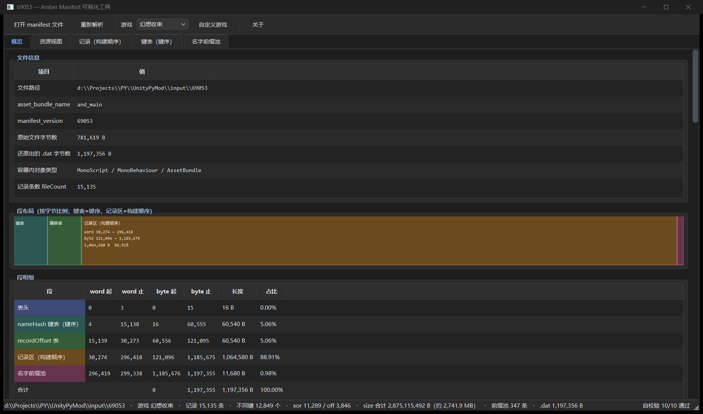
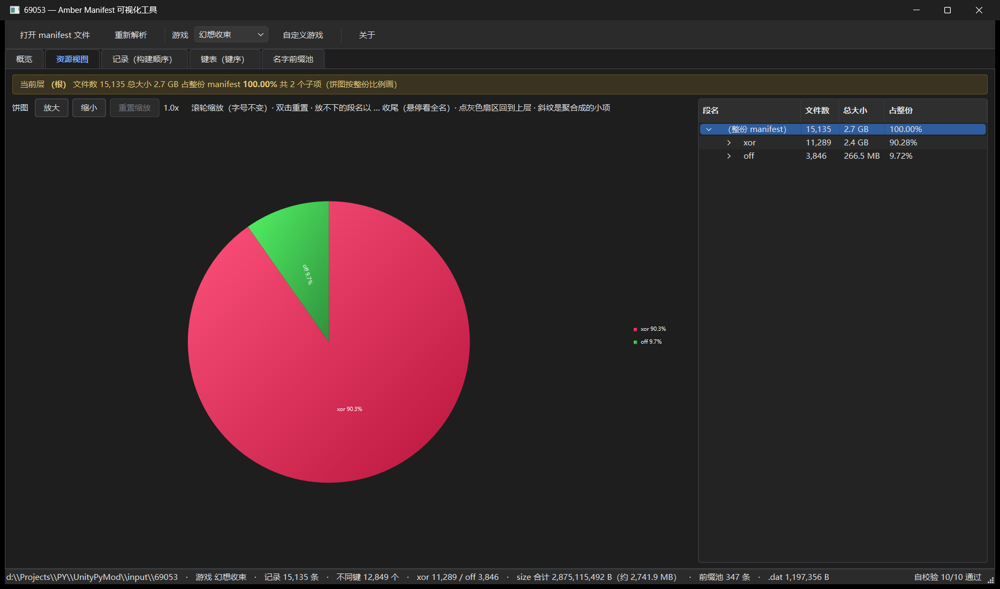
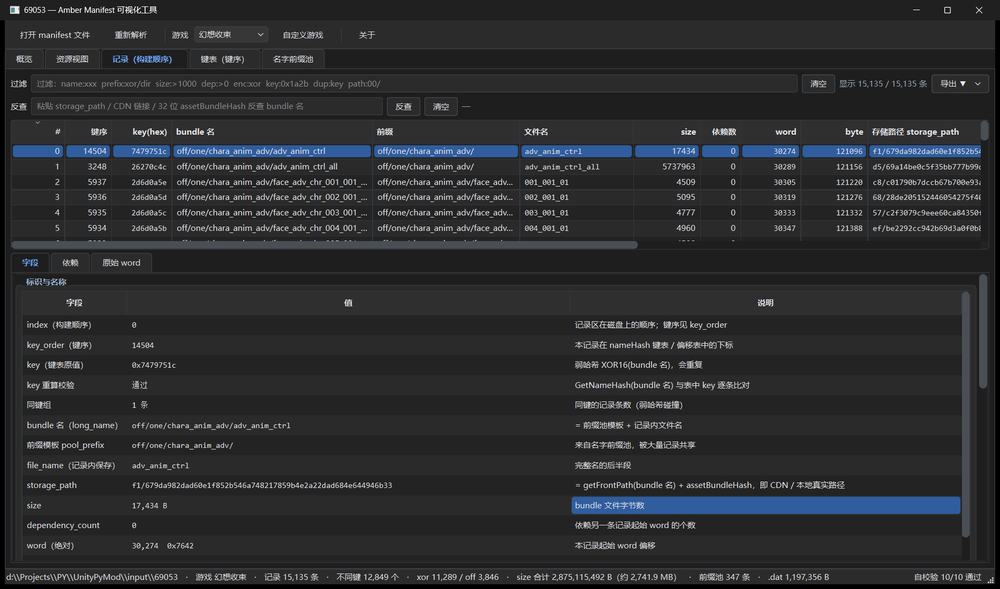

# Amber Manifest Tool

解析《魔法禁书目录 幻想收束》（Amber 框架）manifest 的 **只读** 可视化工具：把 Unity 容器里的 `AssetBundleData.datas` 还原出来，拆成四段式二进制布局，再用五个视图把「打包了什么、谁依赖谁、CDN 上叫什么名」摆到眼前。

> 同时支持同框架的 **Engage Kill**（工具栏「游戏」一键切换）。
> 工具不修改、不写回任何游戏文件，唯一的写盘行为是导出 `copyfiles.txt` 与 CLI 产物。

`Python 3.11` · `PySide6` · `Windows` · `只读`

**[在线图文教程](https://listenC.github.io/AmberManifestTool/)** &nbsp;·&nbsp; **[下载单文件 exe](https://github.com/ListenC/AmberManifestTool/raw/main/dist/AmberManifestTool.exe)**（v1.1.0，免安装）



## 目录

- [这个工具能做什么](#这个工具能做什么)
- [快速开始](#快速开始)
- [界面总览](#界面总览)
- [游戏（扰动流）](#游戏扰动流)
- [记录页：过滤 / 反查 / 导出](#记录页过滤--反查--导出)
- [命令行批量导出](#命令行批量导出)
- [项目结构](#项目结构)
- [重新打包 exe](#重新打包-exe)
- [常见问题](#常见问题)
- [字段与算法速查](#字段与算法速查)
- [相关文档](#相关文档)

## 这个工具能做什么

| 能力 | 说明 |
| --- | --- |
| 解析 manifest | 打开无扩展名的 manifest 资产，自动读容器 → 取出 `.dat` 字节流 → 拆段 → 建索引 |
| 5 个视图 | 概览（段布局 / 表头 / 自校验 / 统计）、资源视图（目录树 + 大小占比饼图）、记录（构建顺序）、键表（键序）、名字前缀池 |
| 反查 | 拿 `storage_path` / CDN 链接 / 32 位 `assetBundleHash` 反查它属于哪个 bundle |
| 依赖分析 | 单条记录的依赖树（懒加载、循环检测）、谁依赖我、传递闭包个数 |
| 过滤 | `name:` `prefix:` `size:` `dep:` `enc:` 等字段化查询，空白分隔即逻辑与 |
| 导出 | 把「当前过滤结果」或「选中记录」连同全部传递依赖导成 `copyfiles.txt` |
| 批量导出 | `main.py` 遍历 `input/`，把每个 manifest 的产物写到 `output/<name>/` |

## 快速开始

### 方式一：直接用 exe（免安装）

下载 **[dist/AmberManifestTool.exe](https://github.com/ListenC/AmberManifestTool/raw/main/dist/AmberManifestTool.exe)** 双击运行即可，不需要 Python 环境，也不需要旁边的任何 dll / 目录。

> 单文件版每次启动先把自身解压到 `%TEMP%`，冷启动 5~8 秒属正常现象。

### 方式二：源码运行

#### 1. 装依赖

```powershell
git clone https://github.com/ListenC/AmberManifestTool.git
cd AmberManifestTool
python -m venv venv
.\venv\Scripts\python.exe -m pip install -r requirements.txt
```

#### 2. 启动

```powershell
.\venv\Scripts\python.exe -m amber_gui
# 或
.\venv\Scripts\python.exe amber_gui\__main__.py
```

### 打开 manifest

三种方式任选：

1. 工具栏 **「打开 manifest 文件…」**（`Ctrl+O`）；
2. 把文件 **拖进窗口**；
3. 启动时把路径写在命令行里：`AmberManifestTool.exe "D:\...\69053"`。

> manifest 资产通常 **没有扩展名**，文件对话框默认过滤器就是「所有文件 `*`」，直接选文件即可。
> 需要的是本游戏的 manifest 资产（内部含 `Amber.AssetBundleManifestInfo`），普通 AssetBundle / 解包后的资源都不行。

载入成功后状态栏会写：文件路径 · 当前游戏 · 记录条数 · 不同键数 · `xor/off` 条数 · size 合计 · 前缀池条数 · `.dat` 字节数，最右侧是「自校验 N/N 通过」。

## 界面总览

```
┌ 工具栏：打开 manifest 文件… │ 重新解析 (Ctrl+R) │ 游戏 [下拉框] │ 自定义游戏… │ 关于 ┐
├ 概览 ─ 资源视图 ─ 记录（构建顺序） ─ 键表（键序） ─ 名字前缀池 ────────────────────┤
└ 状态栏：解析进度 / 摘要 / 自校验 N/N 通过 ────────────────────────────────────────┘
```

| Tab | 看什么 |
| --- | --- |
| 1 概览 | 段布局（按字节比例的五段条）、段明细、表头字段、十项自校验、全表统计、容器对象 |
| 2 资源视图 | 按 bundle 名分段建树回答「哪些目录最占体积」；饼图始终按整份 manifest 的真实比例画，下钻用灰色「其他目录」补齐，不重新归一化 |
| 3 记录 | 核心表，13 列：构建顺序、键序、键、bundle 名、前缀、size、依赖数、word/byte、`storage_path`、`assetBundleHash`、`fileHash` |
| 4 键表 | `nameHash` 升序数组（**键序 ≠ 记录顺序**），勾选「只看重复键」可查弱哈希碰撞 |
| 5 名字前缀池 | 记录只存文件名片段，完整名 = 池内前缀 + 文件名；带 `X/O`（xor/off）与 `O/D/A`（打包粒度）标志位 |





## 游戏（扰动流）

`storage_path`（CDN / 本地真实路径）= `getFrontPath(bundle 名)` + `assetBundleHash`，而 `getFrontPath` 依赖一张 **256 字节扰动表**，这张表 **分游戏**。选错游戏 → 前缀整段错。

| 下拉显示 | `--stream` 名 | 说明 |
| --- | --- | --- |
| 幻想收束 | `if` | 默认，表 `keyIF` |
| Engage Kill | `ek` | 表 `keyEK` |

切换后会自动重新解析当前文件；只影响 `storage_path`，bundle 名、size、依赖等字段不变。

同框架的其他游戏可以点 **「自定义游戏…」** 注册：

- 粘贴十六进制（`56 91 BC DF …`、`0x56,0x91,…`、`5691bc…` 三种写法都认），或「从文件导入…」（正好 256 字节的 `.bin` 按原始表读，`.txt` / `.json` 按 hex 文本解析）；
- 填游戏名后「添加/覆盖」；内置两项不可删除；自定义项存在本机 QSettings，下次启动仍可选。

## 记录页：过滤 / 反查 / 导出

### 过滤语法

输入框内 **空白分隔多个条件，全部满足才显示**；停 150 ms 自动应用，回车立即应用，右侧「清空」一键复位。

| 写法 | 含义 |
| --- | --- |
| `name:xxx` | bundle 名（完整名 + 文件名）子串，不区分大小写 |
| `path:00/` | `storage_path` 子串 |
| `prefix:xor/dir` | 前缀模板子串 |
| `hash:xxx` / `filehash:xxx` | `assetBundleHash` / `fileHash` 子串 |
| `key:0x1a2b` | 键按十六进制 **前缀** 匹配（`0x` 可省略） |
| `index:123` / `word:0x1f` / `byte:0x7c` / `pool:0x2a0` | 精确值，接受十进制或 `0x` 十六进制 |
| `size:>1000` `size:100-200` `size:<=50` | 数值比较：`N`、`>N`、`>=N`、`<N`、`<=N`、`N-M` |
| `dep:>0` / `dup:key` | 依赖数比较 / 只看同键组大于 1 条的记录 |
| `enc:off` / `enc:xor` | 按前缀池第 1 位标志位过滤（明文 / 加密） |
| `granularity:one` / `dir` / `all` | 按前缀池第 2 位标志位过滤（打包粒度） |
| 裸词（如 `69053`） | 当作 `name:` 子串 |

### 存储路径反查

粘进内容按回车或点「反查」，接受：完整 `storage_path`、CDN 链接、本地绝对路径、裸的 32 位 `assetBundleHash`、本工具导出的整行（取第一列）。三级匹配，越靠前越可信：

| 级别 | 行为 |
| --- | --- |
| `full` | 整条 59 字符 `storage_path` 精确命中 → 跳到那条记录 |
| `hash` | 取输入里最后一段 hex 串的末 32 位（即 `assetBundleHash`）命中 |
| `sub` | 都没中，按子串扫描 → 把表过滤成命中行（等价于 `path:片段`） |

### 导出 copyfiles.txt

过滤条最右侧 **「导出 ▼」**：

| 菜单项 | 导出集合 |
| --- | --- |
| 导出当前过滤结果 + 传递依赖 | 表格里现在显示的所有行（排序不影响集合） |
| 导出选中记录 + 传递依赖 | 表格里高亮选中的行（未选中时取当前行） |

流程：先递归求 **传递依赖闭包**（按 word 反查、按记录下标去重，循环依赖天然收敛）→ 弹保存对话框（默认 `copyfiles.txt`、默认目录为当前 manifest 所在目录）→ 写 UTF-8 每行 `存储路径 <TAB> bundle 名`（`/` 转 `\`）→ 汇报来源、文件数量（去重后含全部传递依赖）、总大小与保存路径。

> 导出行数通常会 **多于** 你过滤出来的行数，因为自动并入了依赖 —— 这是设计行为。

## 命令行批量导出

GUI 用来单文件查问题，批量解析走 CLI：

```powershell
# 目录约定：input/ 放无扩展名的 manifest 资产，产物写到 output/<名字>/
.\venv\Scripts\python.exe main.py
.\venv\Scripts\python.exe main.py --stream ek
.\venv\Scripts\python.exe main.py --stream=if
```

产物（`output/<名字>/`，文件名保留历史 `blockN` 命名，便于与老产物一一对应）：

| 文件 | 内容 |
| --- | --- |
| `<名字>.dat` | 从容器还原出的原始清单字节流 |
| `<名字>.txt` | `storage_path <TAB> bundle 名` |
| `<名字>_block1namehash.txt` | 升序 nameHash 键表 |
| `<名字>_block2asset.txt` | 键 → `record_word` / bundle 名 / size（与 block1 同序） |
| `<名字>_block3filehash.txt` | `fileHash` <TAB> bundle 名 |
| `<名字>_block4depend.txt` | `dependencyCount` + 各依赖 word + bundle 名 |
| `<名字>_block5namepointer.txt` | 前缀池 word 偏移 + bundle 名 |
| `<名字>_manifest.json` | 完整清单 JSON（机器可读） |

CLI 会做三项断言式自校验（格式版本、键表命中、dataHash 一致），不通过直接抛异常停下，适合批量跑。

## 项目结构

```
├─ amber_gui/                  # PySide6 界面（入口 amber_gui/__main__.py）
│  ├─ main_window.py           # 工具栏、标签页、状态栏
│  ├─ panel_overview.py        # 概览
│  ├─ panel_assets.py          # 资源视图（饼图 + 路径树）
│  ├─ panel_records.py         # 记录页（过滤 / 反查 / 详情 / 导出）
│  ├─ panel_keytable.py        # 键表
│  ├─ panel_pool.py            # 名字前缀池
│  ├─ models.py / query.py     # 表格模型、过滤解析、依赖闭包
│  ├─ theme.py / style.qss     # 明暗主题（QPalette + QSS 令牌）
│  └─ loader.py / state.py     # 后台解析线程、跨面板信号
├─ manifest_core.py            # 二进制布局解析 + 自校验（GUI 与 CLI 共用）
├─ manifest_container.py       # Unity 容器（MonoBehaviour）读取
├─ hashcode.py                 # 256 字节扰动表、hash_code / GetNameHash
├─ main.py                     # 命令行批量导出
├─ build_exe.bat               # 打包单文件 exe
├─ manifest_format.md          # 二进制格式文档（逐 word 字段归属、算法推导）
├─ docs/                       # 网页版图文教程（GitHub Pages 发布源，index.html + assets/）
└─ README.md
```

## 重新打包 exe

双击 `build_exe.bat`（内部调用 PyInstaller `--onefile`），产物固定为 `dist\AmberManifestTool.exe`。

- 单文件版每次启动先自解压到 `%TEMP%`，冷启动 5~8 秒属正常；
- 打包前请先 **关掉正在运行的实例**，否则报 `PermissionError: [WinError 5] 拒绝访问`；
- 打包参数都在 `build_exe.bat` 命令行里，PyInstaller 会自动生成 `AmberManifestTool.spec`（生成物，不入库）。

## 常见问题

| 现象 | 原因 / 处理 |
| --- | --- |
| 双击 exe 后没反应 | 单文件版先自解压，等 5~8 秒；仍无窗口看同目录 `AmberManifestTool_crash.log` |
| 提示「无法解析该文件」 | 选错文件了。必须是含 `Amber.AssetBundleManifestInfo` 的 manifest 资产 |
| `storage_path` 前缀明显不对 | 工具栏「游戏」选错，切换后会自动重解析 |
| 记录页看不到某条记录 | 过滤条件还在生效，点「清空」或看计数标签里的「条件：…」 |
| 导出的行数比过滤结果多 | 正常，自动并入了全部传递依赖（去重后） |
| 点导出提示没有可导出的记录 | 过滤结果为空或未载入 manifest，先清空过滤或选中若干行 |
| 依赖树「全部展开」中途停止 | 节点超过 5000 上限（菱形依赖会膨胀），改用逐层展开 |

## 字段与算法速查

`storage_path` 结构（合计 59 字符，实测全表唯一）：

```
xx/                     2 字符 = hash_code(名字, 0) & 0xff 的 hex
<8 位 hex>              hash_code(名字, 1)
<8 位 hex>              zlib.crc32(名字)
<8 位 hex>              hash_code(名字, 3)
<32 位 hex>             assetBundleHash（记录内 4 个 u32）
```

| 哈希 | 算法 | 用途 |
| --- | --- | --- |
| `nameHash`（键） | `GetNameHash`：长名 → 64 字节缓冲 → 16 个 u32 异或（XOR16） | 键表升序 + 二分查找；弱哈希，会碰撞 |
| `dataHash` | `HashFromUInts`：整表 word 小端展开（word 0 按 0 计） | 整表一致性自校验 |
| `fileHash` | `HashFromBytes(bundle 内容)`，两个字节累加器相加再异或 | 下载后完整性校验，**不是密码学哈希** |

两种「顺序」别混：**构建顺序**（记录表 `#` 列）= 磁盘排列顺序；**键序** = `nameHash` 升序数组下标。二者靠 `recordOffset` 表（`record_word`）互相映射。

## 相关文档

- [网页版图文教程](https://listenC.github.io/AmberManifestTool/) —— 在线版（GitHub Pages）；本地也可直接打开 docs/index.html
- [manifest_format.md](manifest_format.md) —— 二进制格式细节：每个 word 的字段归属、§13 算法推导、实测数据

## 免责声明

仅供学习交流与个人研究使用，请勿用于任何商业用途或分发游戏资源；解析对象的所有权利归原厂所有。
